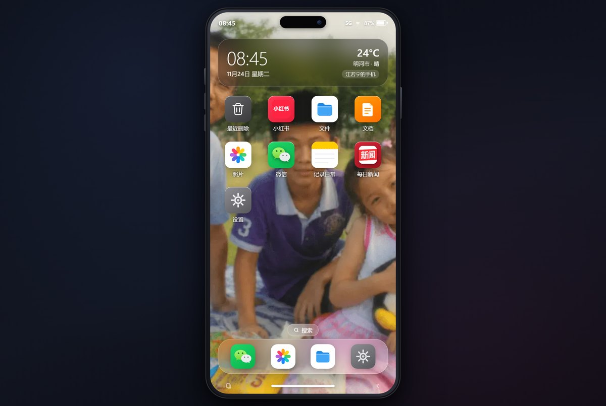

<div align="center">



<h1>《宁宁的手机》</h1>

<p><b>《宁宁的电脑》手机端重做移植版</b><br>
<sub>基于 bcmh《魔法兔兔》的手机 UI 重设计 · A mobile-OS remake of the PC ARG</sub></p>

<p>


</p>

</div>

---

本项目是将原版 PC 端微恐解谜 ARG 游戏《宁宁的电脑》**重构移植为拟态智能手机系统（参考 iOS / iPhone 交互体验）**的完整版本。移植过程**100% 保留原版全部图片、音效、视频素材、三周目剧情、谜题机制、彩蛋与三结局分支**，仅对操作系统外壳、视觉图标、触控逻辑与内置应用界面进行了移动端深度重做。

> 原作：《魔法兔兔》 by **@bcmh_ovo**。剧情、文本、美术、音频与全部世界观设定版权归原作者所有。

---

## 核心改动说明

### 1. 拟态手机系统外壳（`phone-os.css` / `phone-os.js`）

- 移动端访问自动全屏铺满，桌面端自动呈现拟态手机机身画框预览。
- 新增顶部状态栏、灵动岛动态提示、右上角下拉控制中心（音量静音、屏幕亮度、锁屏、息屏、重置与全部应用快捷入口）、主屏天气时钟小组件、四列圆角图标网格、毛玻璃底部 Dock 与 iOS 底部 Home Indicator 手势条（支持轻触 / 上滑回主屏与多任务卡片切换）。

### 2. 全链路触控适配（`js/mobile.js`）

- 将原版 PC 端双击打开图标、文件夹、照片与手机储存的操作全部统一为移动端单击响应。
- 锁屏页支持跟手上滑或轻触解锁；密码逻辑严格保持原版设定（首次无提示，输错后显示原提示）。

### 3. 内置应用深度去 PC 化

- 移除原版 Windows 窗口边框、最小化 / 最大化 / 关闭按钮及资源管理器工具栏，统一改为 iOS 顶部 `< 返回` 导航。
- 替换全部电脑显示器、文件夹与回收站图标为 iOS 风格圆角矢量图标。
- 「此电脑 / 本地磁盘 (C:)」重构为「文件 / 我的 iPhone 储存空间」；「照片」重构为方形网格相册；「微信」改为移动端底部标签栏与列表 / 聊天二级切换；「设置」重构为 iOS 分组列表与「关于本机 / 传输或还原 iPhone」；「蓝屏」重构为手机内核崩溃页（支持点击二维码进入故障支持页）。

### 4. 离线纯净优化

- 移除第三方统计脚本，并在 `file://` 本地打开场景下跳过后台跨域预加载，避免控制台报错。

---

## 目录结构

| 路径 | 说明 |
|---|---|
| `index.html` | 手机首次开机向导、开机动画、锁屏与密码解锁入口 |
| `pc.html` | 手机主屏幕及全部内置 App（微信、小红书、每日新闻、文件、照片、文档、记录日常、最近删除、浏览器、设置等） |
| `bluescreen.html` | 手机系统崩溃内核错误页 |
| `support.html` | 移动端设备支持页（含原版故障特效） |
| `tuzi.html` | 《兔子先生》内嵌交互页 |
| `phone-os.css` / `phone-os.js` | 拟态手机系统样式与核心交互控制器 |
| `js/`、`image/`、`xhs/`、`pyq/`、`pt/`、`hands/`、`rabbit/`、`audio/`、`videos/` | 原版核心逻辑脚本与全部原始媒体素材 |
| `preview/` | README 截图 |

## 运行与部署方式

由于游戏包含本地进度存储（`localStorage`）与多页面跳转，建议通过静态服务器或托管平台运行。

**本地快速启动**：解压后在项目根目录执行：

```bash
python3 -m http.server 8080
# 或
npx serve .
```

然后浏览器打开 <http://localhost:8080/>（首次进入为开机向导，密码在游戏内线索里）。

**部署**：纯静态站点，无构建步骤。

- GitHub Pages：仓库 `Settings → Pages`，分支 `main`、目录 `/` 即可；
- 或 Cloudflare Pages / Vercel / Netlify，构建命令留空、发布目录填 `/`。

---

## 修复记录

### 2026-11-24 · 二周目拼图在手机壳下无法完成

- **现象**：进入二周目后 9 块碎片变成主屏上的图片图标，但怎么拖都不动，也无法拼合。
- **原因**：`phone-os.css` 为了让图标落进弹簧板网格，统一加了 `left: auto !important`，把图标的内联坐标压掉了；而原作 `checkCreepyPuzzle()` 正是靠每块碎片的内联 `left/top` 判断拼合。坐标被锁死后，拖动只改数值、画面不动。
- **修法**：新增 `#phone-puzzle-layer` 绝对定位画布，把碎片从网格里取出后恢复触摸拖拽与 3×3 拼合；拼好后延迟收起并露出新出现的图标。同时修掉了"碎片被判成占位而弹回原位"和"碎片拖到左上角被误丢进回收站"两个连带问题。

### 2026-11-24 · 设置窗口压住其它应用

- **现象**：打开「设置」后再从控制中心打开别的应用，新应用看不见。
- **原因**：`#win-settings` / `#win-hospitalpdf` 挂在 `#desktop` 之外，而 `#desktop` 带 `z-index: 1` 自成层叠上下文，导致这两个窗口永久置顶。
- **修法**：初始化时把它们收回 `#desktop`，并让 `zIndexCounter` 从 100 起算，`bringToFront()` 才真正生效。

---

## 版权与致谢

- **原作：《魔法兔兔》 by @bcmh_ovo** —— 剧情、谜题、文本、美术、音频及全部世界观设定版权归原作者所有。
- 本仓库仅重写**界面外壳与交互方式**，属同人性质的 UI 重设计移植，**不主张对原作内容的任何权利**。
- 仓库内不包含原作之外的商业素材；如原作者认为本移植不妥，提出后立即下架。
- 原作设定为虚构作品，所有人物、事件、线索均为虚构。

> 游玩须知（摘自原作）：感谢游玩，魔法兔兔！！！目前作者 @bcmh_ovo 还在接着完善内容。

<div align="center"><sub>如果你喜欢这部作品，请去支持原作者。</sub></div>
