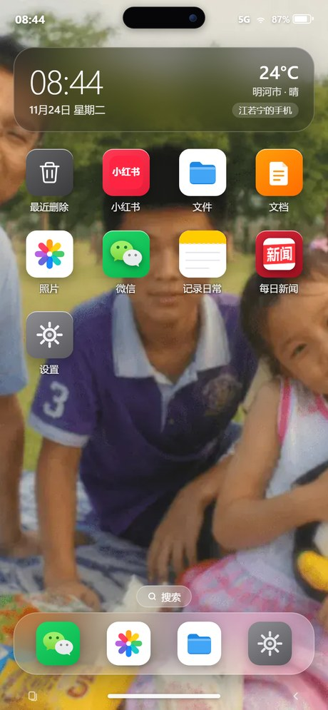
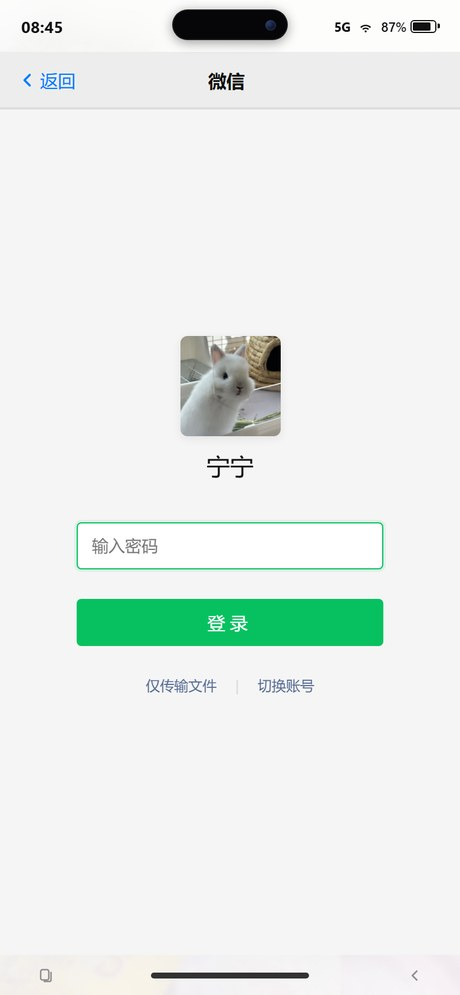

<div align="center">


<h1>宁宁的手机</h1>

<p><b>基于 bcmh《魔法兔兔》的手机 UI 重设计版</b><br>
<sub>A mobile-OS redesign of bcmh's <i>魔法兔兔 (Magic Rabbit)</i></sub></p>

<p>


</p>

</div>

---

## 这是什么

原作《魔法兔兔》把玩家放进一台**家用电脑的 Windows 10 桌面**里，靠回收站、聊天记录、日记、相册和一堆看似无害的文件推进一段微恐的解谜剧情。

这个仓库做的是**同一段故事的另一副壳子**：把"电脑桌面"整体换成一台**手机**。

- 剧情、谜题、三周目结构、三个结局 —— **全部沿用原作，未做任何删改**
- 只替换外壳与交互：Windows 10 桌面 → 一套原生风格的手持 OS（仓库里叫 **NingOS**）
- 所有美术、音频、文本资源均来自原作，本仓库不改动它们

> 换句话说：**内容没动，只是从"坐在电脑前"变成"拿起这部手机"。**

## 界面

| 主屏 | 微信 |
|---|---|
|  |  |

重设计的外壳包括：

- **状态栏**：时间 / 信号 / Wi-Fi / 电量，随周目变化
- **灵动岛**：通知脉冲、当前应用胶囊
- **主屏**：图标网格自动整理、iOS 风格的统一图标绘制（全部手写 SVG，不依赖图片）
- **Dock 与搜索**：底部四个常驻入口
- **控制中心**：亮度调节、静音、快捷开关
- **多任务切换器**：卡片式切换与关闭
- **推送通知**：微信消息以系统通知形式弹出
- **侧滑返回 / 回到主屏**：手势导航
- **主题联动**：应用内配色随界面明暗切换

## 怎么玩

直接用浏览器打开即可，不需要安装、不需要构建。

```
index.html   →  首次开机（含使用须知、EULA 与免责声明）
pc.html      →  手机桌面本体
```

- 建议**戴耳机**，本作含微恐与音效设计
- 单周目约 **30 分钟 ~ 1 小时**，共 **3 个结局**
- 进度自动保存在浏览器本地（localStorage），换设备/清缓存会丢失

### 本地运行

因为 `sw.js` 需要 HTTP 环境，直接双击 `file://` 打开会有部分功能异常，用任意静态服务器即可：

```bash
# Python
python -m http.server 8000

# 或 Node
npx serve .
```

然后访问 <http://localhost:8000/pc.html>。

### 部署

纯静态站点，把仓库根目录直接丢给 GitHub Pages / Cloudflare Pages / Vercel 即可，无需构建命令。

## 目录结构

```
.
├── index.html          首次开机页（须知 / EULA）
├── pc.html             手机桌面（游戏主体）
├── phone-os.css        手机 OS 外观层（本仓库新增）
├── phone-os.js         手机 OS 行为层（本仓库新增）
├── mobile.css          移动端适配
├── pc.css              原作桌面样式（保留）
├── style.css           开机页样式
├── tuzi.html           站内小站（原作彩蛋）
├── bluescreen.html     蓝屏页
├── support.html
├── sw.js / version.js  Service Worker 与缓存版本
├── js/                 游戏逻辑（沿用原作）
├── image/ xhs/ pt/ hands/ pyq/ rabbit/   图片与彩蛋素材
├── audio/ videos/      音频与过场视频
└── preview/            README 用的截图
```

**新增文件是 `phone-os.css` 与 `phone-os.js`**（外壳层）；`index.html`、`pc.html`、`tuzi.html` 等入口页做了少量接入改动（例如 `pc.html` 追加两行引用）。图片、音频、视频等素材与原作保持一致。

## 技术说明

- 纯 HTML + CSS + 原生 JS，**零依赖、零构建**
- 两套滚动/布局体系并存：桌面端仍可显示手机边框，移动端自动全屏
- Service Worker 版本化缓存 + 网络优先代码 / 缓存优先媒体，支持二次访问离线游玩
- 图标全部为内联 SVG，不新增图片请求

## 版权与致谢

- **原作：《魔法兔兔》 by @bcmh_ovo**
  剧情、谜题、文本、美术、音频及全部世界观设定版权归原作者所有。
- 本仓库仅重写**界面外壳与交互方式**，属于同人性质的 UI 重设计移植，**不主张对原作内容的任何权利**。
- 仓库内不包含原作之外的商业素材；如原作者认为本移植不妥，提出后我会立即下架。
- 原作设定为虚构作品，所有人物、事件、线索均为虚构。

> 游玩须知（摘自原作）：感谢游玩，魔法兔兔！！！目前作者 @bcmh_ovo 还在接着完善内容。

<div align="center"><sub>如果你喜欢这部作品，请去支持原作者。</sub></div>
